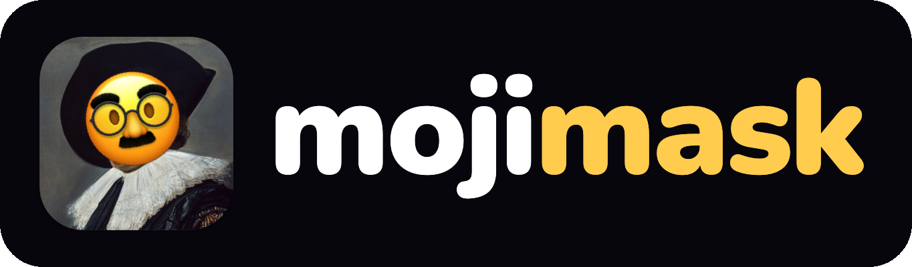
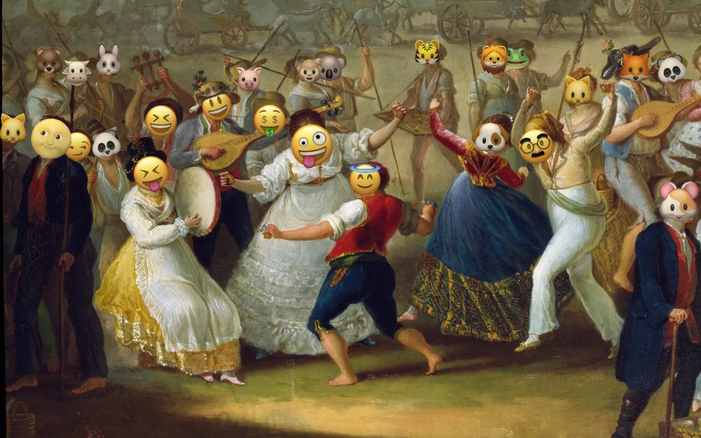

<p align="center">
  
</p>

<p align="center">
  Face masking for dance parties, protests and other complex videos.<br>
  Offline, free and open source.
</p>

<p align="center">
  <a href="https://github.com/acgourley/mojimask/releases/latest/download/Mojimask.dmg"><b>Download for macOS</b></a>
  &nbsp;·&nbsp; <a href="docs/media/jazz-walkthrough.mp4">Watch the 45 second demo</a>
  &nbsp;·&nbsp; <a href="https://acgourley.github.io/mojimask/">Website</a>
  <br><sub>Requires Apple Silicon. Nothing leaves your Mac.</sub>
</p>

<p align="center">
  
</p>

## What it does

Crowds, strobe lights, fast motion can confuse other tools. Mojimask uses research grade machine learning to find,
follow and understand each person in the scene.

- **Finding:** YOLOv5-Face and RetinaFace detect and double-check faces. YOLO11x-pose finds heads even when faces
  are hidden, and tilts the masks.
- **Following:** optical flow follows each person from frame to frame, and SFace and OSNet-AIN recognise them when
  they reappear.
- **Depth:** Depth Anything V2 keeps faces at different distances apart and layers covers behind whatever is in
  front of them.
- **Human judgement:** for the perfectionist, the app will still ask you to weigh in on the tricky cases. Automatic
  judgements can be modified; set custom masks or unmask the consenting.
- **Masks:** emoji presets, blur, pixelate, or even upload a sticker, with options to match scene lighting and body
  pose.

## Building it

Needs an Apple-silicon Mac with Python 3.11, [uv](https://docs.astral.sh/uv/), cmake and ninja
(`brew install cmake ninja`).

```bash
uv venv .venv --python 3.11
uv pip install --python .venv/bin/python -r requirements.txt
./packaging/build_opencv.sh      # a small OpenCV, ~5 min
# put the model files in models/: see models/README.md
.venv/bin/python desktop.py      # run it from source
./packaging/build_mac.sh         # or build it: dist/Mojimask.app and dist/Mojimask.dmg
```

## Contributing

See [CONTRIBUTING.md](CONTRIBUTING.md), including how to work with AI coding tools here. How to run, change and
measure the app: [AGENTS.md](AGENTS.md), written for coding agents and people alike.

## Licence

AGPL-3.0 (see `LICENSE`), which the bundled YOLO11 pose model (Ultralytics, AGPL-3.0) requires. Model
weights have their own licences, listed in `models/README.md`; everything else bundled is in
`THIRD_PARTY_NOTICES.md`.
